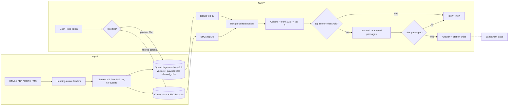

# Enterprise RAG Knowledge Platform

A company knowledge assistant. It answers questions from a mixed document set (SEC 10-K filings, arXiv papers,
Wikipedia pages, internal HR policies), cites its sources, says "I don't know" when the evidence is missing, and
only retrieves documents the user's role may see.

Built for the Nexvia Technologies GenAI internship, project GENAI-01.

## Architecture



| Layer | Choice |
|---|---|
| Framework | LlamaIndex (`SentenceSplitter`, `VectorStoreIndex`, `QdrantVectorStore`, metadata filters) |
| Vector DB | Qdrant (embedded local mode by default; server mode via `QDRANT_URL`) |
| Embeddings | `BAAI/bge-small-en-v1.5` via fastembed (local, CPU) |
| Keyword search | BM25 (`rank-bm25`), corpus filtered by role before scoring |
| Fusion | Reciprocal rank fusion, k = 60 |
| Reranker | Cohere `rerank-v3.5`; falls back to local `BAAI/bge-reranker-base` if no key |
| LLM | Any OpenAI-compatible API; tested with `openai/gpt-4o-mini` on OpenRouter |
| Evaluation | RAGAS (faithfulness, answer relevancy, context precision) + custom checks |
| Tracing | LangSmith (`@traceable` on the chain and retriever, wrapped OpenAI client) |
| API / UI | FastAPI + React (Vite) |

## Data and roles

| Role sees | Source | Format | Docs | Chunks |
|---|---|---|---|---|
| `finance` | SEC EDGAR 10-K: Apple (FY2025), Microsoft (FY2026), NVIDIA (FY2026) | HTML | 3 | 813 |
| `research` | arXiv: RAG, Transformer, DPR, ColBERT, ReAct, RAGAS, BEIR | PDF | 7 | 337 |
| `hr` | Northwind Analytics HR policies (synthetic, written for this project) | DOCX | 5 | 20 |
| everyone (`all`) | Wikipedia: 12 articles on IR, LLMs, Apple, Microsoft, Nvidia, SEC, ... | HTML | 12 | 442 |
| `admin` | everything | | 27 | 1,612 |

`employee` only sees the public (`all`) documents. (A demo upload, `scripts/demo_upload.ps1`, adds one
finance-only memo; it was added after the evaluation.) The HR policies are synthetic so the project has realistic
private Word documents; they are generated by `scripts/hr_policies.py` and saved as `.docx`.
`scripts/collect_data.py` downloads everything else from the public sources (links in `data/manifest.json`).

**Chunking.** Loaders split each file by structure first: HTML by `h1`-`h4` headings and 10-K "Item X." headings,
DOCX by heading styles, PDF by page. Each section is split with LlamaIndex `SentenceSplitter` (512 tokens, 64
overlap), so a chunk never crosses a section boundary. Wikipedia boilerplate sections (References, See also, ...)
are dropped. Each chunk keeps `title`, `section`, `page`, `url`, `source`, `allowed_roles`, and the section
header is prepended to the embedded text.

**Access control.** The role filter runs *before* retrieval: a Qdrant payload filter
(`allowed_roles` in `[role, "all"]`) and a BM25 index built only from the chunks that role may see. A restricted
chunk can never reach the reranker or the LLM.

## Results

See [`eval/results/REPORT.md`](eval/results/REPORT.md) for the full table; per-question outputs are in
`eval/results/*.jsonl`.

| Mode | Faithfulness | Answer relevancy | Context precision | Answered (answerable) | IDK accuracy (unanswerable) | Role leaks | p50 / p95 latency |
|---|---|---|---|---|---|---|---|
| Dense only | 0.904 | 0.821 | 0.812 | 93% (40/43) | 100% (12/12) | 0 | 1.7 s / 2.8 s |
| Hybrid (dense + BM25, RRF) | 0.951 | 0.881 | 0.902 | 100% | 100% | 0 | 1.8 s / 2.7 s |
| **Hybrid + Cohere rerank** | **0.980** | 0.880 | **0.955** | 100% | 100% | **0** | 2.2 s / 3.2 s |

- RAGAS metrics use `gpt-4o-mini` as the judge and are averaged over all 43 answerable questions (every sample
  scored; judge calls that timed out were re-run with a longer timeout).
- Role leaks: 0 restricted chunks were retrieved for any of the 63 questions in any mode, and 0 of the 8 role-leak
  answers contained the protected fact. All 8 were refused with "I don't know".
- The expected source document was in the top 5 for every answerable question in every mode (doc hit@5 = 1.0).
  This metric is saturated because the questions name their source (e.g. "According to NVIDIA's 10-K"), so it
  does not separate the modes; context precision does.
- Rerank adds about 0.4 s at p50. Latency excludes waiting on the Cohere trial-key rate limit.
- LLM cost for answering 63 questions: about $0.015 per mode.
- The evaluation script ran with LangSmith tracing accidentally switched off. Afterwards all 63 questions were
  replayed through the API with tracing on (`eval/replay_api.py`); the replay gave the same 20 "I don't know"
  answers (12 unanswerable + 8 role-leak).

Evaluation set: [`eval/questions.jsonl`](eval/questions.jsonl), 63 questions: 43 answerable (29 drafted by the LLM
from random chunks then reviewed and edited by hand, 14 written by hand), 12 unanswerable, and 8 role-leak tests
(a user asks for facts that exist only in documents their role cannot see).

## Run it (no Docker)

Requires Python 3.12 with [uv](https://docs.astral.sh/uv/) and Node 20+.

```bash
cp .env.example .env            # add LLM_API_KEY, COHERE_API_KEY, LANGSMITH_API_KEY
uv sync
uv run python scripts/collect_data.py   # download corpus (~30 MB)
uv run python scripts/build_index.py    # chunk + embed + index (~8 min on CPU)
uv run python scripts/ask.py hr "How many days of annual leave do we get?"

cd frontend && npm install && npm run build && cd ..
uv run uvicorn app.api:app --port 8000  # UI + API on http://localhost:8000
uv run python eval/run_eval.py          # full evaluation (~25 min; Cohere trial key = 10 calls/min)
uv run pytest
```

For UI development run `npm run dev` in `frontend/` (proxies API calls to port 8000).

## Run it (Docker)

`docker-compose.yml` runs a Qdrant server and the API (which serves the built UI). This path was written but **not
tested**, because Docker was not available on the development machine.

```bash
docker compose up -d qdrant
docker compose run --rm api uv run --no-sync python scripts/collect_data.py
docker compose run --rm api uv run --no-sync python scripts/build_index.py
docker compose up -d api
```

## API

Auth is a demo stand-in (real auth is out of scope): send `Authorization: Bearer <token>`. Tokens map to roles in
`DEMO_TOKENS`: `finance-token`, `research-token`, `hr-token`, `employee-token`, `admin-token`.

| Method | Path | Role | Body / result |
|---|---|---|---|
| `POST` | `/chat` | any | `{"question": str, "mode": "hybrid_rerank" \| "hybrid" \| "dense"}` -> answer, `idk`, `citations[]` (n, title, section, page, url, snippet), `top_rerank_score`, `latency_ms` |
| `POST` | `/feedback` | any | `{"request_id", "rating": 1 \| -1, "comment"}`; stored in `storage/feedback.jsonl` |
| `POST` | `/admin/upload` | admin | multipart `file` (.pdf/.docx/.html/.md/.txt), `allowed_roles` (e.g. `finance,hr` or `all`), `title`; indexed immediately |
| `GET` | `/admin/docs` | admin | index stats and document list |
| `GET` | `/health` | none | status, reranker, model, counts |

Interactive docs: `http://localhost:8000/docs`.

## Project layout

```
app/        config, loaders, store (chunking, Qdrant, BM25), retrieval, rag, api
scripts/    collect_data, build_index, ask, hr_policies
eval/       questions.jsonl, draft_questions.py, run_eval.py, results/
frontend/   React + Vite chat and admin UI
tests/      unit tests (fusion, role filter, loaders, chunking, auth)
```

## Limitations

- Demo-token auth only. A real deployment needs SSO and per-document ACLs from the source system.
- The corpus is 27 documents / 1,612 chunks; the design (payload filters, batched embedding) scales further, but
  that was not measured here.
- The same model (`gpt-4o-mini`) answers and judges in RAGAS, which can bias scores upward.
- Latency numbers exclude time spent waiting on the Cohere trial-key rate limit (10 calls/min); that wait is
  reported separately as `rate_limit_wait`.
